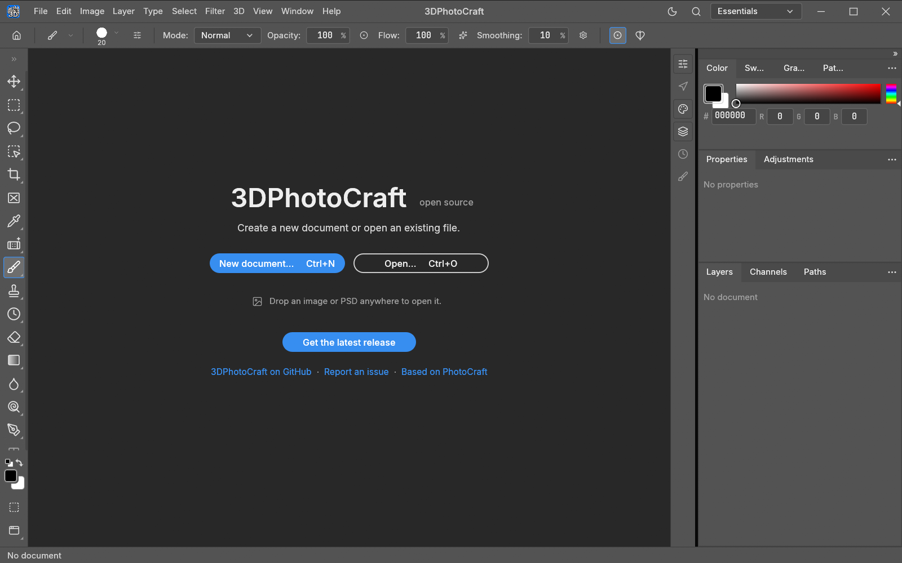

# 3DPhotoCraft

**A native image editor for Windows with Photoshop's old 3D workspace brought back.** Paint, retouch and
composite as in any layered editor, then turn layers into 3D objects, light them, and ray trace the result
back into your document.

3DPhotoCraft is an independent project. It is based on [PhotoCraft](https://github.com/storytold/photocraft)
by the ArtCraft team (MIT OR Apache-2.0) and is not made, sponsored or endorsed by them.



## Download

Get the latest version from the [Releases page](https://github.com/VibeCodedSoftware/3DPhotoCraft/releases/latest):

| File | What it is |
|---|---|
| `3DPhotoCraft-1.0.0-setup.exe` | **Recommended.** Installs for your Windows account (no administrator rights), adds Start menu and desktop shortcuts, and can be removed from *Settings › Apps*. |
| `3DPhotoCraft-1.0.0-windows-x64.zip` | Portable. Unzip anywhere and run `photocraft.exe`. Settings stay in the folder. |

Windows 10 or 11, 64-bit. The program isn't code-signed yet, so Windows SmartScreen may warn the first
time: choose **More info › Run anyway**.

## What's in it

- **A full layered image editor:** layers, masks, adjustment layers, layer styles, selections, brushes,
  filters, type and vector shapes; PSD, TIFF, PNG, JPEG, WebP, HEIF and more.
- **The 3D workspace** (*3D* menu and *Window › 3D*):
  - New 3D layers from OBJ, STL, glTF and GLB models, keeping their materials and textures.
  - Extrude type, shapes, pixels, selections or paths into 3D, with depth, twist, taper, bend and bevels.
  - Mesh presets (cube, cylinder, sphere, soda can, wine bottle and more) and depth-map meshes, wrapped with
    a layer.
  - Materials with textures from files or layers, lights and light presets, cameras and image-based light.
  - A live CPU preview and a ray-traced *Render 3D Layer*, so it runs on any PC without a special GPU.
  - Export to OBJ, STL, glTF and GLB.
- **Command line and automation:** `photocraft-cli.exe` and an MCP server can drive the same commands.

The full 3D guide is in [docs/3d.md](docs/3d.md) (also shipped as `3D-GUIDE.md`).

## Build from source

Needs [Rust](https://rustup.rs/) (stable, MSVC toolchain on Windows).

```powershell
$env:CARGO_TARGET_X86_64_PC_WINDOWS_MSVC_RUSTFLAGS = '-C target-feature=+crt-static'
cargo build --release -p photocraft -p photocraft-cli --features heif --target x86_64-pc-windows-msvc
powershell -ExecutionPolicy Bypass -File packaging\windows\package-3d-portable.ps1
```

The last step writes the portable zip to `dist\release`.

## License and credits

3DPhotoCraft is licensed under **MIT OR Apache-2.0** (see [LICENSE-MIT](LICENSE-MIT) and
[LICENSE-APACHE](LICENSE-APACHE)). It is based on PhotoCraft by the ArtCraft team and contributors, under the
same licenses. Third-party components and their licenses are listed in [NOTICE](NOTICE) and
[ATTRIBUTION.md](ATTRIBUTION.md).

PhotoCraft and ArtCraft are names of the ArtCraft team. This repository doesn't include the ArtCraft logos, and
3DPhotoCraft isn't an ArtCraft product. Adobe and Photoshop are trademarks of Adobe Inc.; 3DPhotoCraft isn't
affiliated with Adobe.
